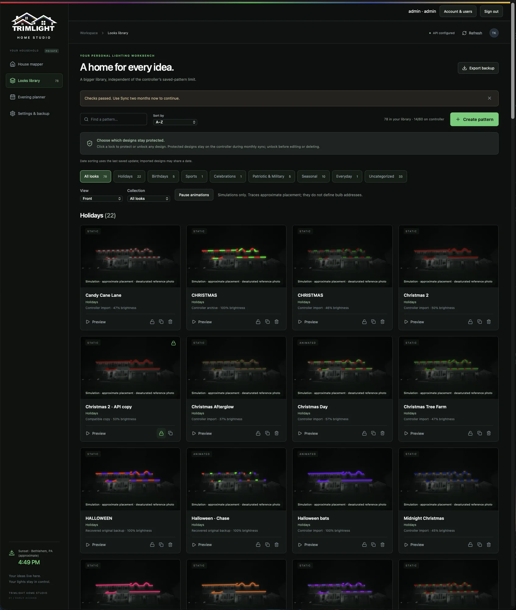
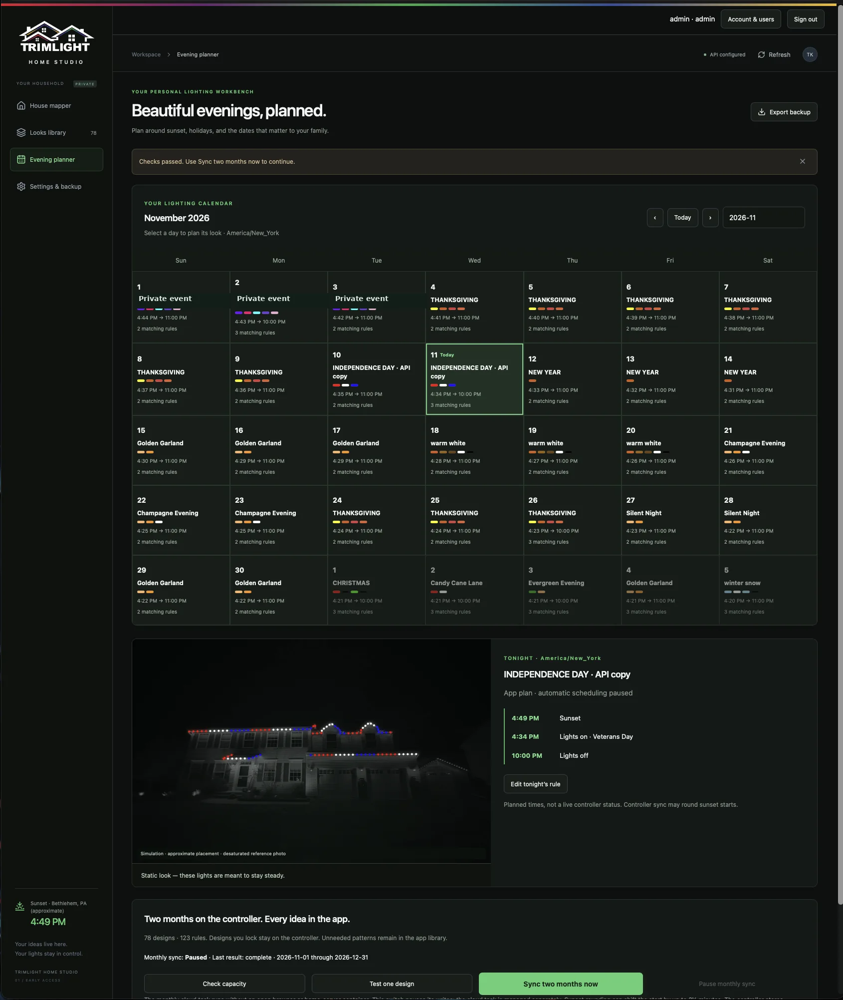
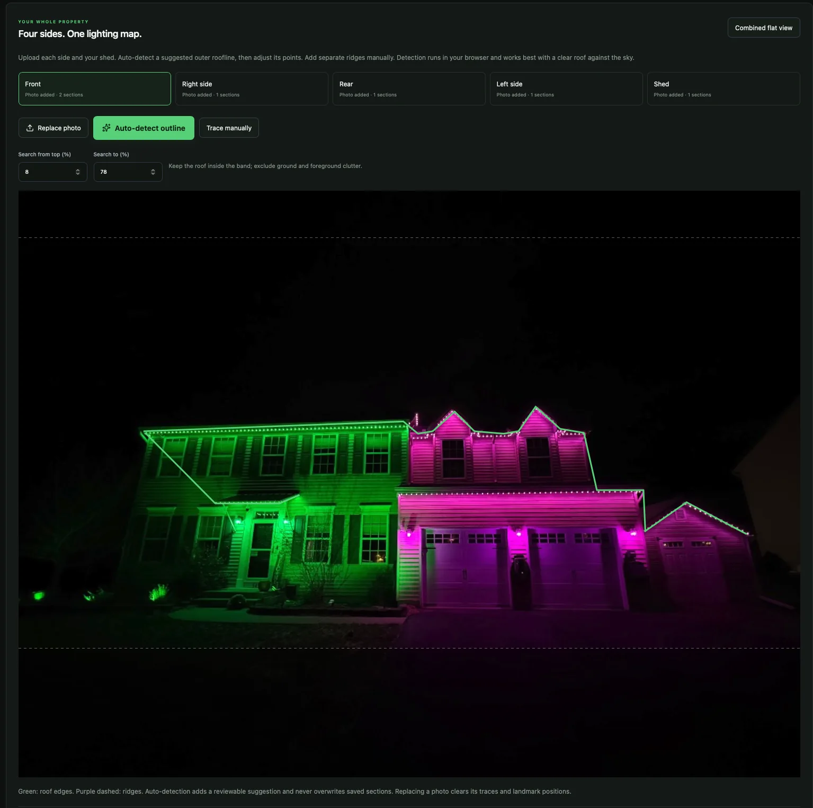
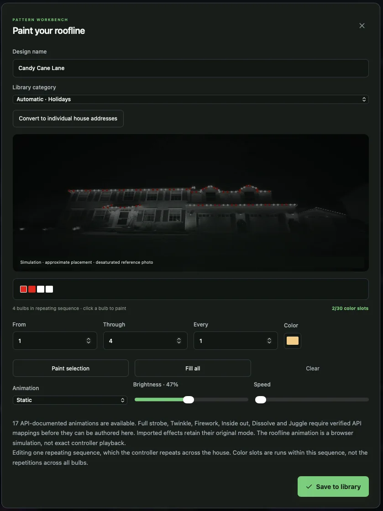

# Trimlight Home Studio

An independent, self-hosted lighting design and scheduling application for compatible Trimlight controllers. Each household runs its own server and supplies its own API credentials through Settings.

<!-- screenshots:start -->
## Screenshots

Explore the early-access interface for house mapping, pattern design, and calendar-based lighting. Screenshots show simulated roofline placement; controller playback and calendar synchronization require validation against real hardware.

| Pattern library | Evening planner |
| :-- | :-- |
|  |  |

| House mapper | Pattern workbench |
| :-- | :-- |
|  |  |

[View the complete screenshot gallery](docs/screenshots/README.md), including individual-bulb painting, custom roofline zones, settings, backup and restore, and two-month scheduling.

<sub>Early-access screenshots; selected personal calendar entries and location coordinates are obscured for public release.</sub>
<!-- screenshots:end -->

## Features
- Pattern library with sorting and user-selected protected designs.
- Native repeating-sequence editing and individual bulb/range/increment painting.
- Four house views plus a shed, editable roofline detection and flat property diagrams.
- Calendar rules, sunset offsets, local scheduling and two-month controller planning.
- Encrypted credential storage, authenticated server access and workspace backups.

## Quick start
Requires Docker with Compose.

```sh
cp env.example .env
# Set APP_USER and a unique APP_PASSWORD of at least 8 characters in .env.
docker compose up -d --build
```

Open `http://localhost:8888`, sign in, and configure **Settings → Trimlight connection**. Enter your API client ID and secret, click **Find controllers**, then select your controller and **Test & save**. Set your location, time zone and bulb count before enabling scheduling. New installs start empty and import controller patterns when first connected.

See [HOME_SERVER.md](HOME_SERVER.md) for installation, backups, credential management and operating details.

## Development
Requires Node.js 24 or newer.

```sh
npm ci
npm run build
npm test
# Set APP_USER, APP_PASSWORD and DATA_DIR in your environment before starting:
npm start
```

`npm run dev` serves the frontend only; use the built Node server for authenticated API integration.

## Release status and limitations
This is an early community release. Controller calendar synchronization and recovery have an unresolved readback mismatch and require further hardware validation. Keep a controller backup and verify results in the native app before relying on calendar synchronization. Automated tests do not operate physical lights. Roofline detection supplies an editable suggestion rather than a surveyed model.

Each server supports one household/controller. The local scheduler must remain running. Controller capacity limits still apply; storing more designs in the app does not increase controller memory. Protect the data volume and use HTTPS or a VPN for remote access.

## Project scope
This public source snapshot excludes the original household data, credentials, controller backups, private deployment settings and private Git history. It contains the self-hosted application rather than the private ChatGPT hosting integration.

This is an independent project, not an official Trimlight product or an endorsed application. Trimlight names and supplied logos remain the property of their respective owners. No trademark rights are granted.

## License
This project's original source code and documentation are licensed under the **GNU General Public License, version 3 or (at your option) any later version (GPL-3.0-or-later)**. See [LICENSE](LICENSE) for the full license text.

Community members may use, modify, redistribute, and fork the project, subject to the GPL's requirements, including preservation of applicable notices and provision of corresponding source code when required. Independent forks and contributions are welcome. This license does not grant rights to third-party trademarks, branding, or other materials not owned by the project's contributors.
