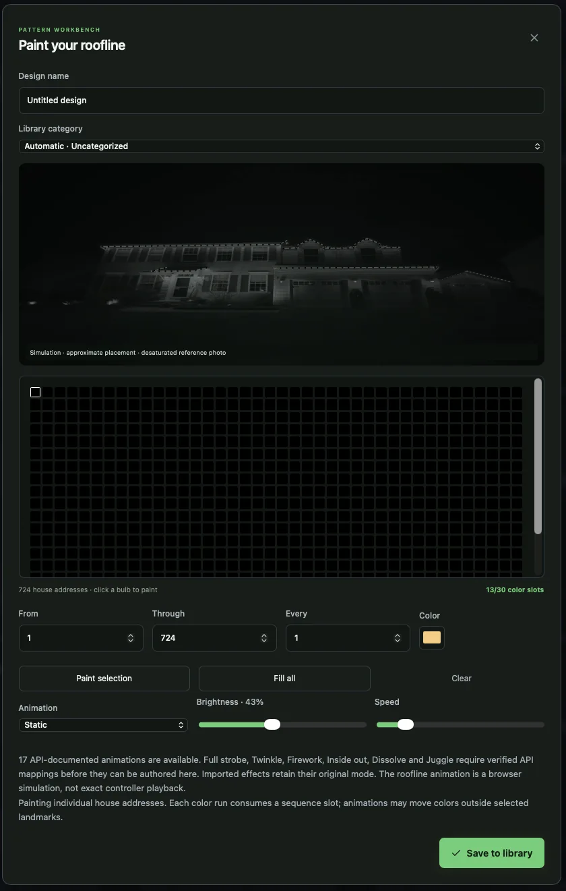
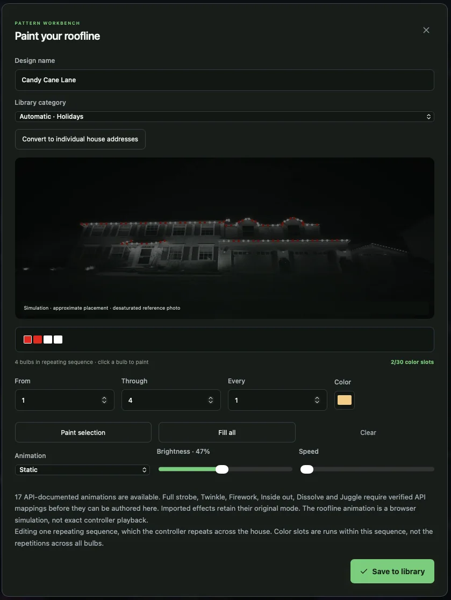
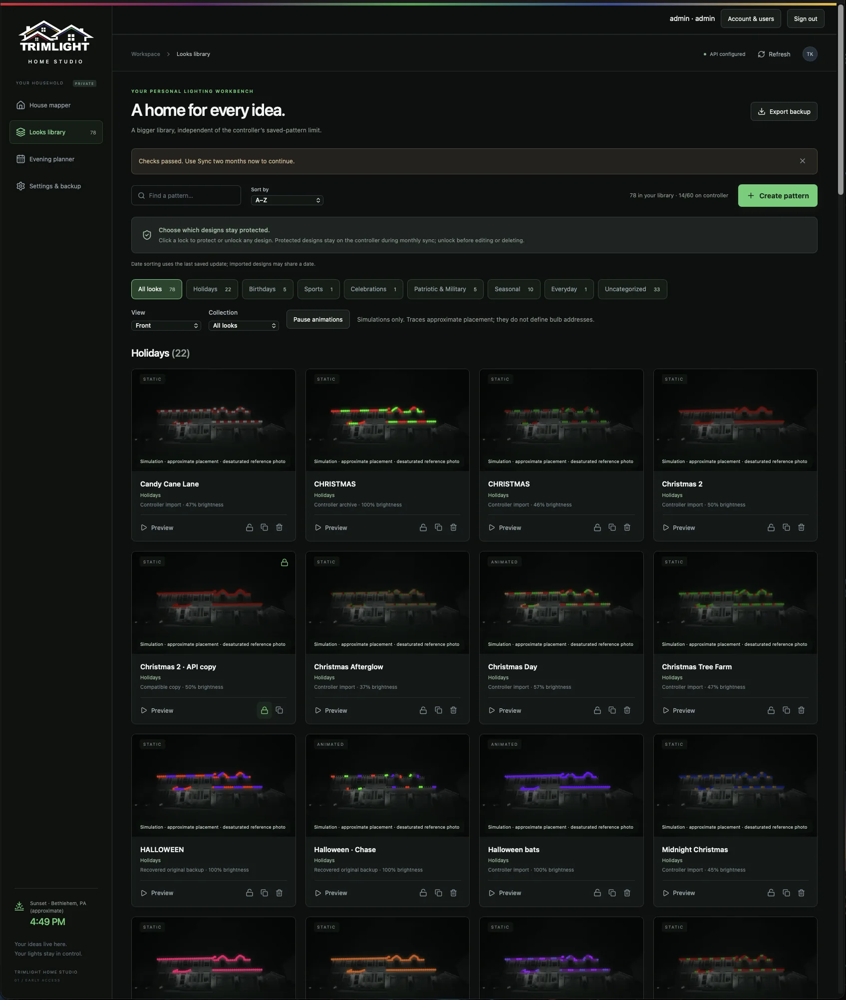
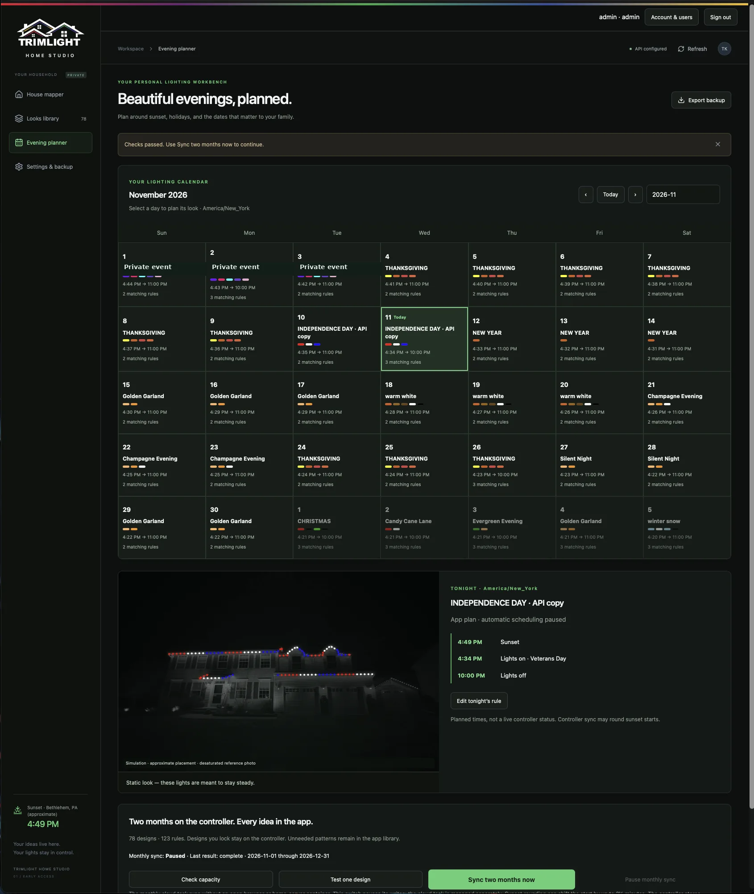
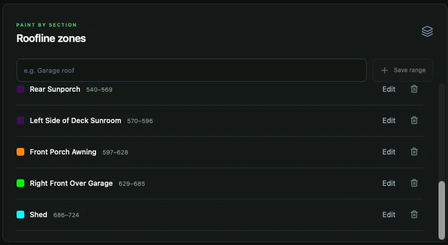
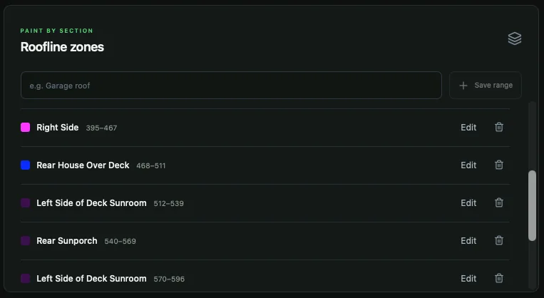
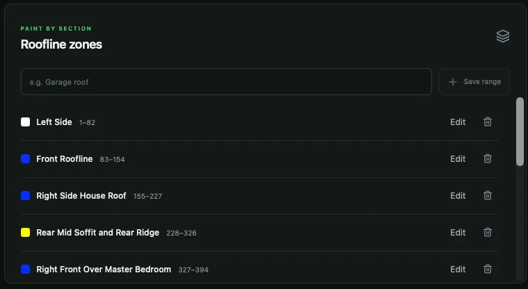
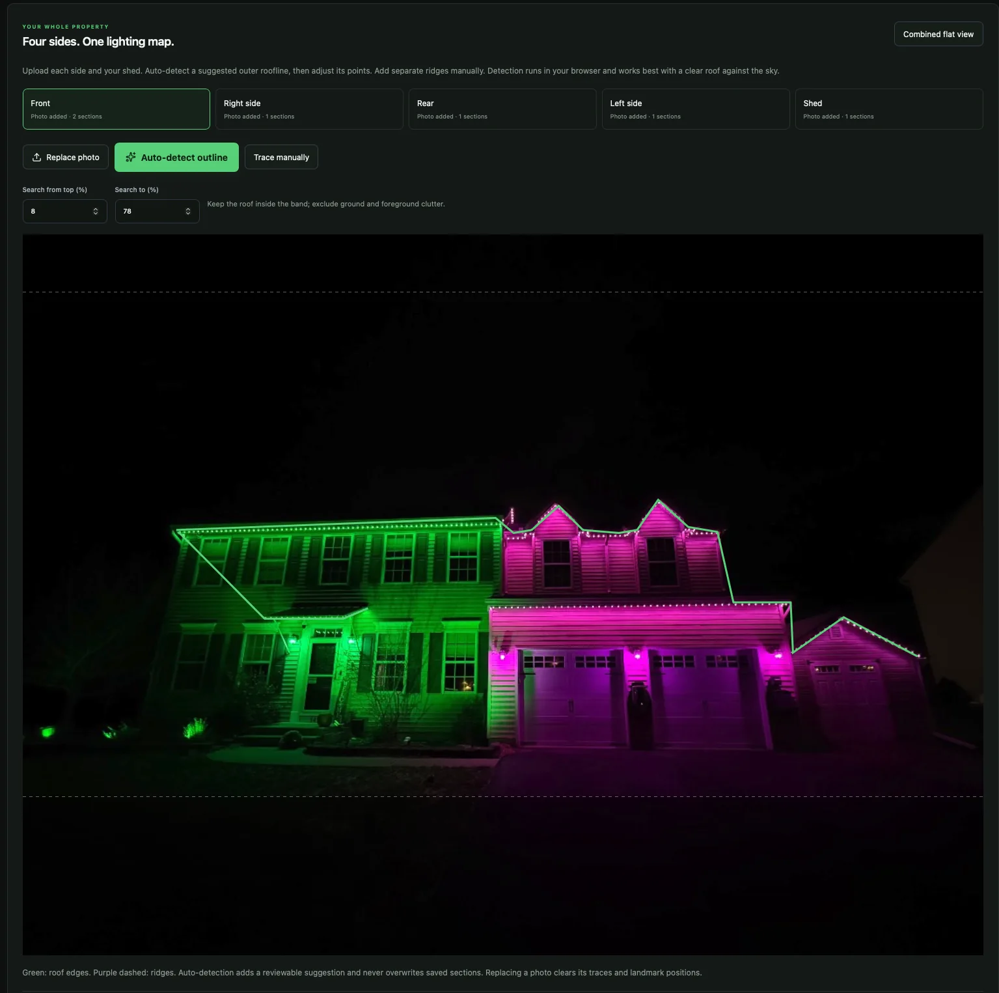
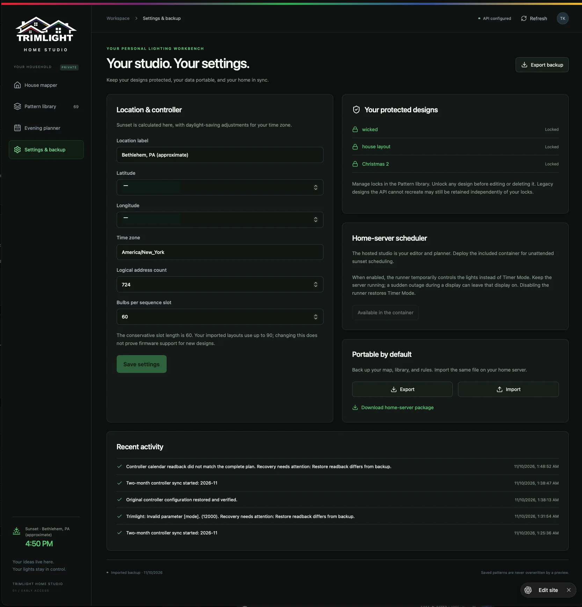
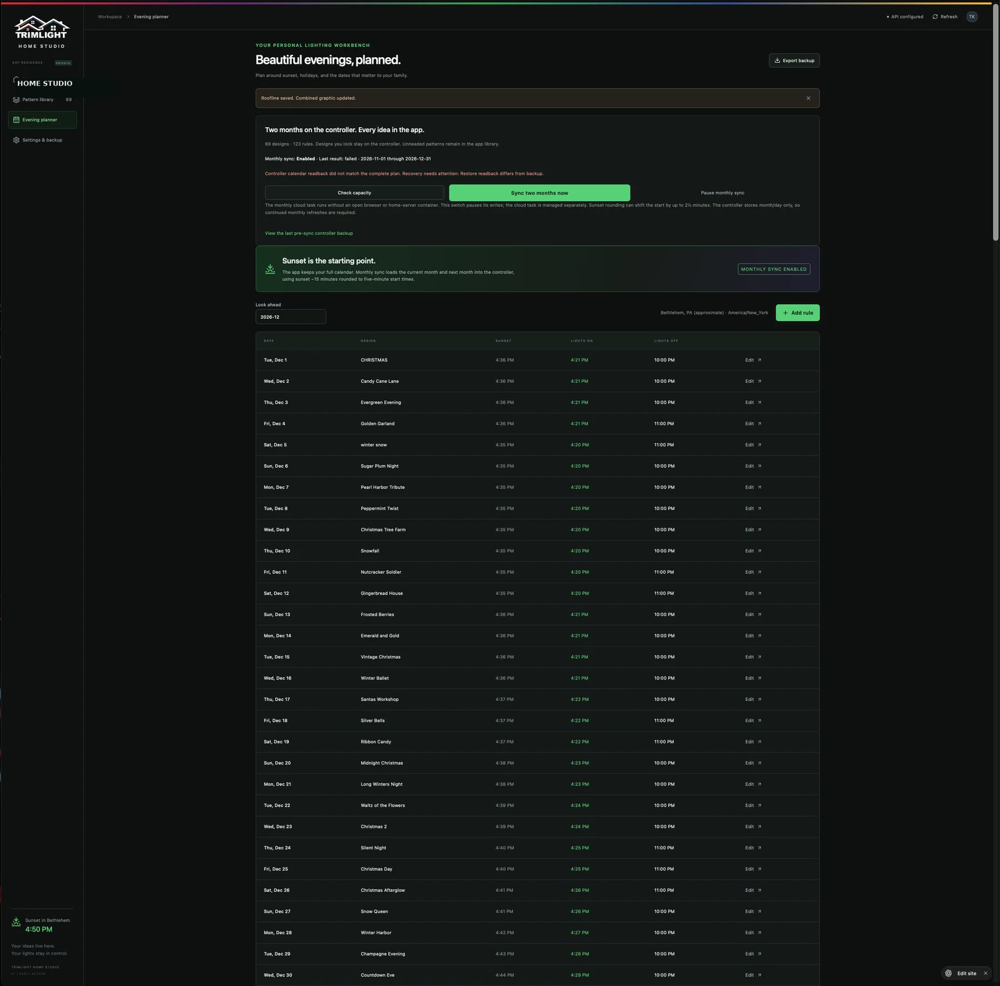

# Trimlight Home Studio — Screenshot Gallery

These screenshots illustrate the early-access user interface. Roofline placement is an approximate simulation, not a surveyed light map or a guarantee of controller behavior. Calendar synchronization and playback require hardware validation.

Personal calendar entries, a household name, and location-coordinate values have been obscured in selected screenshots.

### Individual Bulb Painting

Paint individual logical house addresses, apply ranges, and preview effects.

### Repeating-Sequence Editor

Edit repeating color sequences before converting to individual house addresses.

### Pattern Library

Browse, filter, protect, and preview a large local library of lighting designs.

### Evening Planner Calendar

Plan nightly looks using calendar rules, holidays, and sunset-relative timing.

### Roofline Zones — Rear

Define and edit named logical-address ranges for rear sections.

### Roofline Zones — Middle

Manage overlapping or adjacent roofline zone groups.

### Roofline Zones — Front

Map the first logical-address regions to the front of the home.

### House Mapper

Upload a house photo, detect roofline outlines, and adjust traced segments.

### Settings and Backups

Configure local controller settings, protect patterns, and export or import workspace backups.

### Two-Month Schedule

Preview the planned monthly controller schedule and sunset-relative on/off times.
